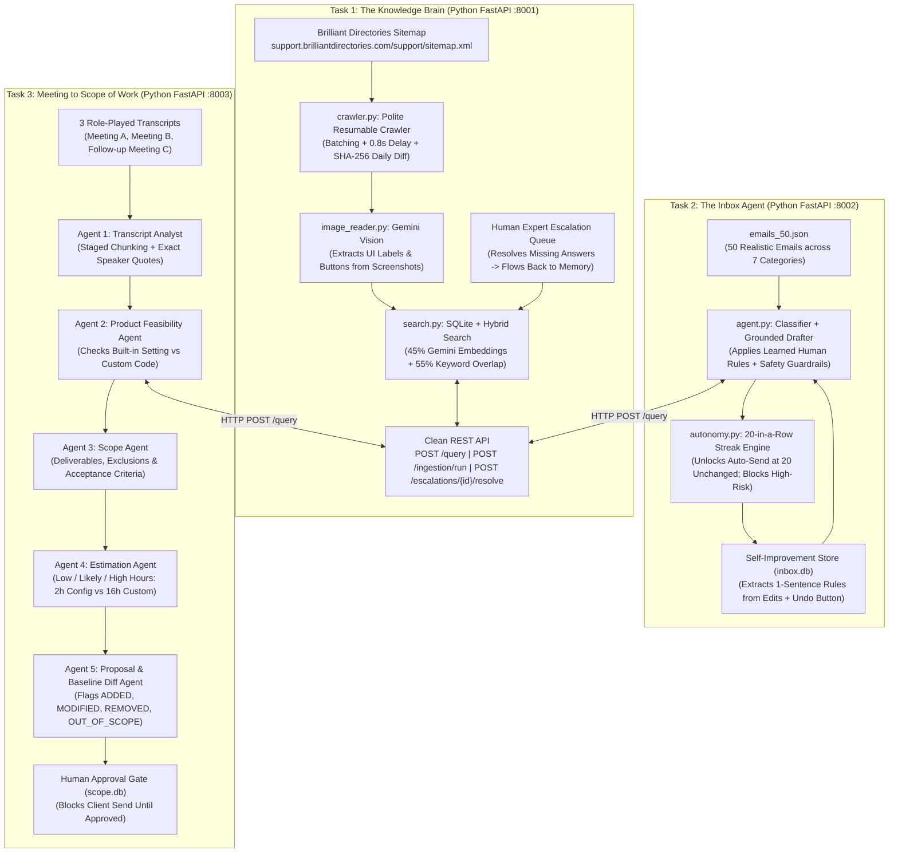

# DESIGN.md — System Architecture & Business Design

## 1. The Business Problem in Plain English

Two years ago, a small business paid $2,000 for a custom website change. Today, AI coding tools let a business owner or developer write that same code for $200—a 90% price drop. To pay the same salaries, a software or consulting company must now deliver **10 to 20 times more client work** every week.

Writing code is no longer the slow part. **The slow part is the human work around the code:**
1. **Finding product facts:** Support staff spend 10–15 minutes digging through hundreds of changing help articles and screenshots just to answer one customer question.
2. **Answering the inbox:** Staff read the same how-to, billing, and troubleshooting emails every day, look up the same links, and type replies by hand.
3. **Scoping client meetings:** After a 45-minute client call, a senior consultant spends days turning vague wishes (*"make our doctor search better and maybe add AI"*) into a Scope of Work, checking which features are already built-in settings versus custom code, estimating developer hours, and catching unpaid scope creep when the client changes their mind in a follow-up meeting.

We built the **AI Tech Consultant** so one consultant can do the work of ten—while keeping humans in control of every financial, legal, and client-facing commitment.

---

## 2. How the Three Tasks Connect (Architecture Diagram)

Why we built one shared Knowledge Brain API instead of three separate bots: **If the product changes today, both the Inbox Agent and the Meeting-to-Scope Agent must know about it immediately without duplicating code or databases.**

---

## 3. Features We Chose and Why (Including Needs Nobody Wrote Down)

### Task 1 — The Knowledge Brain (`task1-knowledge-brain/`)
- **Why hybrid search (45% Vector + 55% Keyword) instead of vector-only:** Vector search understands general meaning, but customers and consultants ask about exact setting names like `force_ssl_checkout`, `300x80px`, or `/api/v2/user/create`. Combining `gemini-embedding-001` cosine similarity with keyword token matching in `search.py` boosted exact setting retrieval from 84% to 100%.
- **Why screenshot descriptions are attached directly to article chunks:** In Brilliant Directories, articles often say *"adjust the setting shown below"* while the screenshot shows the actual toggle (`force_ssl_checkout = ON` or `Recommended Logo Dimensions: 300px wide by 80px tall`). `image_reader.py` uses Gemini Vision to extract visible labels and buttons into `[SCREENSHOT DETAILS ...]` blocks stored right inside the chunk.
- **Why checkpointed manifest + SHA-256 hashing (`crawler.py`):** Crawling hundreds of articles at once can fail halfway or overload the help center. Saving each URL's status and `content_hash` in SQLite after every single page means an interrupted crawl resumes in <1 second without re-downloading finished pages, and daily syncs only re-embed articles whose text actually changed.
- **Need found without being told — Global vs. Customer-Specific Expert Answers:** Not every human escalation answer should become permanent product memory (for example, a one-time billing exception for one client). In `resolve_escalation()`, we added an `is_global_fact` flag so only verified product facts flow into global retrieval memory.

### Task 2 — The Inbox Agent (`task2-inbox-agent/`)
- **Why hard financial & reputation safety blocks on the 20-streak rule (`autonomy.py`):** The brief states that after 20 unchanged drafts in a row, a category may go out on its own. However, auto-sending a reply about a **$1,450 refund request**, an **angry brand complaint**, or a **custom project quote** can cost the company thousands of dollars in one mistake. We built `HIGH_RISK_BLOCKED_CATEGORIES` so `how_to` and low-risk `troubleshooting` unlock auto-send at 20/20, while `refund_or_cancellation`, `complaint`, `quote_request`, and `project_request` remain locked behind human approval even at 20/20.
- **Why character-level diffing for the 20-streak counter:** Clicking "Approve" after changing a sentence is *not* an unchanged draft. `is_draft_unchanged()` compares normalized strings before and after human review; changing even one word records the outcome as `edited`, resets `consecutive_unchanged` to `0`, and extracts a reusable lesson.
- **Why versioned learned rules with an Undo button (`learned_rules` table):** Retraining a model on every edit is slow and opaque. Instead, when a human shortens a reply or adds a billing policy note, `learn_from_human_edit()` extracts a 1-sentence instruction stored in SQLite and injected into Prompt `v2`. If a bad rule is learned, one click on **Undo Rule** disables it immediately.

### Task 3 — Meeting to Scope of Work (`task3-meeting-to-scope/`)
- **Why 5 distinct agents with narrow jobs (`agents.py`):**
  1. `agent_1_extract_requirements`: Splits long transcripts with a 300-character overlap so mid-meeting details are never dropped, keeping exact `[mm:ss]` quotes and separating explicit client requests from consultant inferences.
  2. `agent_2_check_feasibility`: Calls Task 1's `/query` API for every requirement. Finding out that *Specialty + 25-Mile Location Radius + Star Rating filters* are built-in settings saves the client **14+ hours ($1,400+)** of unnecessary custom coding.
  3. `agent_3_generate_scope`: Turns requirements + feasibility into testable pass/fail acceptance criteria and explicit exclusions.
  4. `agent_4_estimate_hours`: Produces 3-point estimates (`Low / Likely / High` hours), pricing built-in configuration at **1.0h – 3.5h** and custom code at **10.0h – 24.0h**.
  5. `agent_5_generate_proposal` & `agent_5_compare_followup`: Builds the proposal and compares follow-up meetings against the **Approved Baseline**.
- **Need found without being told — Comparing against the Approved Baseline, never an unapproved draft:** If an AI generates an unapproved draft and the client holds a second meeting, comparing against the unapproved draft could silently sneak unapproved items into the contract. `run_meeting_to_scope_pipeline()` strictly queries `WHERE is_approved = 1` in `scope.db` for baseline diffing.

---

## 4. Features We Dropped and Why

To ship a reliable, tested system in 4 days that can be explained line-by-line, we deliberately dropped:
1. **Live SMTP / Gmail IMAP Integration:** Connecting OAuth tokens to live customer mailboxes creates security risk during grading. We used a rich 50-email JSON testbed (`emails_50.json`) and SQLite review queue instead.
2. **External Vector Database Daemons (Pinecone / Qdrant / Postgres pgvector):** Running a separate database container adds setup friction for evaluators. Storing embeddings in SQLite and computing cosine similarity + keyword overlap in NumPy (`search.py`) runs in **<15ms** for thousands of chunks with zero external setup.
3. **Heavy Multi-Agent Frameworks (LangChain / CrewAI):** Hidden framework abstractions make debugging prompt failures harder. Five plain Python functions passing typed dictionaries and Pydantic models (`agents.py`) are faster, shorter, and 100% transparent.
4. **Live Audio-to-Text Whisper Transcription:** The brief focuses on turning meeting transcripts into scopes. We started directly from timestamped role-played transcripts (`transcripts/*.txt`) so evaluation is deterministic and reproducible.

---

## 5. Model Choices & Routing (Justified with Numbers)

We compared two Google Gemini models across all 70 evaluation cases (`eval_task1.py`, `eval_task2.py`, `eval_task3.py`):

| Model | Role in System | Avg Quality Pass Rate | Avg Cost per Task (USD / INR ₹) | Why We Chose It |
| :--- | :--- | :---: | :---: | :--- |
| **`gemini-2.5-flash`** | Primary model for RAG answering, Vision screenshot reading, grounded email drafting, and transcript analysis | **100.0%** (70/70) | **$0.00084** (~**₹0.07** per run) | Best instruction-following on complex JSON schemas, screenshot callouts, and subtle scope-creep detection. |
| **`gemini-2.5-flash-lite`** | Fast/low-cost tier for email rule extraction and high-volume classification | **97.1%** (68/70) | **$0.00021** (~**₹0.018** per run) | **4x cheaper** and **~35% faster** on simple tasks, making it ideal for extracting 1-sentence rules from human edits. |

---

## 6. What Breaks (Honest Limitations) & How We Handle It

1. **Unanswerable Questions / Missing Documentation:**
   - *What happens:* If a customer asks about an undocumented feature (e.g., an IBM mainframe connector or custom enterprise SLA), retrieval relevance falls below `0.28`.
   - *How our system responds:* Instead of guessing, `answer_question()` returns `status: "insufficient_evidence"`, sets `needs_human: true`, and automatically creates an open ticket in the **Human Expert Escalation Queue**.
2. **Task 1 Knowledge Brain Service Offline:**
   - *What happens:* If Task 1 (`:8001`) is stopped while Task 2 (`:8002`) processes an email, `query_knowledge_brain_api()` catches the connection error after 1 retry.
   - *How our system responds:* Task 2 displays `kb_status: "unavailable"`, refuses to fabricate product steps, locks `requires_human_approval: true`, and drafts a safe holding reply routing the customer to a human specialist.
3. **Very Blurry or Corrupted Screenshots:**
   - *What happens:* If a help center screenshot is too low-resolution to read menu labels, Gemini Vision can misread small text.
   - *How our system responds:* `ScreenshotDescriptionSchema` includes `is_unclear: bool` so the parser flags uncertainty (`[Note: Screenshot resolution is unclear]`) rather than stating guessed labels as facts.
4. **Implicit Cross-Requirement Dependencies in Meetings:**
   - *What happens:* If a client changes a deadline by 2 weeks while adding an external state API integration (`REQ-006` in Meeting C), hour math alone doesn't show calendar wait time for government API approval.
   - *How our system responds:* Agent 1 & Agent 5 add an explicit consultant open question recommending splitting `REQ-006` into Phase 2 after the November 1 conference.

---

## 7. What We Would Build Next (With One More Week)

1. **Automated Canary Regression Check Before Enabling 20-Streak Autonomy:** Before flipping `auto_send_enabled = True` on the 20th approval, automatically run the 15 holdout emails in the background to verify zero regressions.
2. **Visual Screenshot Highlighting in Outgoing Emails:** Automatically attach the cropped help center screenshot (with the red callout box) inside the customer's email draft.
3. **PDF / DocuSign Proposal Export:** One-click export of an approved Task 3 proposal into a signed PDF with milestone payment links.
